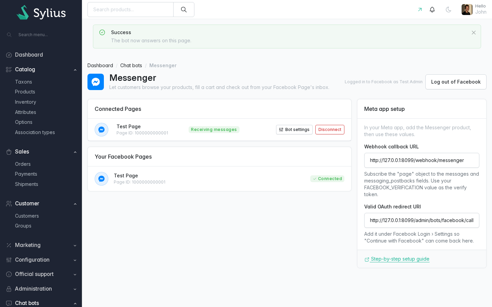
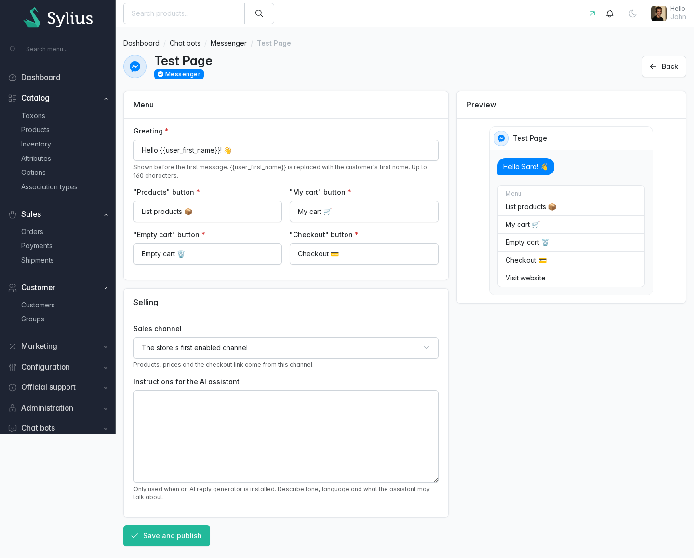
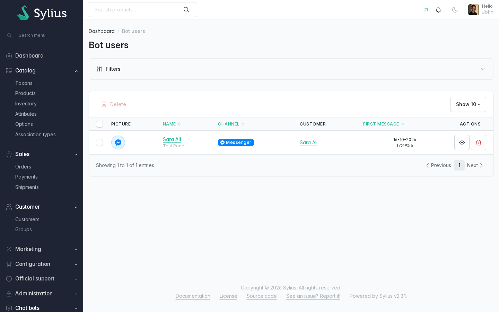
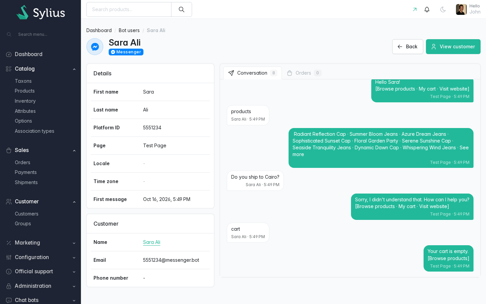

<h1 align="center">
    
    <p>Sylius Bot Plugin</p>
</h1>

<p align="center">Sell from <b>Facebook Messenger</b> and <b>Instagram Direct</b>: customers browse your catalogue, fill a cart and check out without leaving the chat.</p>

<p align="center">
    
    
    
</p>

<p align="center"></p>

## Features

- **Messenger and Instagram** from one plugin, using the Messenger Platform (Instagram Direct goes through the Facebook Page the account is linked to).
- **Connect with Facebook** from the admin: log in, pick your Pages or Instagram accounts, done. The plugin subscribes the Page to your app's webhooks and publishes its menu. Page tokens are looked up server side and never reach the browser.
- **Shopping in the chat**: product carousels with prices and images, add to cart, view and empty the cart, and a checkout button that opens the regular Sylius checkout with the chat's cart.
- **Persistent menu, greeting and Get Started**, editable per page with a live preview.
- **Bot users**: a grid of everyone who wrote to your pages, each linked to a Sylius customer, with their **conversation** and **orders** on one page.
- **Delivery health**: each connected page shows whether Meta still delivers its messages, and a *Repair* button when it does not (expired token, lost webhook subscription).
- **Safe webhooks**: every call is checked against Meta's `X-Hub-Signature-256` signature; all events of a batch are processed; echoes and receipts are ignored.
- **Bring your own AI**: free-text questions go to a `ReplyGeneratorInterface` you can implement with any LLM. It can answer, recommend products (shown as cards, re-checked against live stock) or trigger the cart and checkout. Without one, the bot answers with its menu.
- Text commands for clients that show no buttons (`products`, `cart`, `checkout`, `hi`), English and Arabic translations.

| Connected pages | Bot settings |
| --- | --- |
|  |  |
| **Bot users** | **A bot user's conversation and orders** |
|  |  |

## Requirements

| | Version |
| --- | --- |
| PHP | 8.2 or newer |
| Sylius | 2.1, 2.2, 2.3 |
| A Meta app | with the Messenger and/or Instagram products |
| A public HTTPS URL | for Meta's webhooks (use a tunnel such as ngrok when developing) |

For Sylius 1.12, use `ahmedkhd/sylius-bot-plugin:v1.12`; for Sylius 1.8 to 1.10, `^1.1`.

## Installation

1. Require the plugin:

    ```bash
    composer require ahmedkhd/sylius-bot-plugin
    ```

2. Register the bundle in `config/bundles.php` if Flex did not:

    ```php
    SyliusBotPlugin\SyliusBotPlugin::class => ['all' => true],
    ```

3. Import the configuration, e.g. in `config/packages/sylius_bot.yaml`:

    ```yaml
    imports:
        - { resource: "@SyliusBotPlugin/config/config.yaml" }
    ```

4. Import the routes, e.g. in `config/routes/sylius_bot.yaml`:

    ```yaml
    sylius_bot:
        resource: "@SyliusBotPlugin/config/routes.yaml"
    ```

5. Add your Meta app's credentials to `.env.local`:

    ```dotenv
    FACEBOOK_APP_ID=your-app-id
    FACEBOOK_APP_SECRET=your-app-secret
    # Any random string; you will paste the same value in the Meta app's webhook settings.
    FACEBOOK_VERIFICATION=a-long-random-string
    # Optional, defaults to v23.0
    FACEBOOK_GRAPH_VERSION=v23.0
    ```

6. Create the tables and clear the cache:

    ```bash
    bin/console doctrine:migrations:migrate
    bin/console cache:clear
    ```

7. Set up the Meta app (webhook URL, OAuth redirect URI, permissions) by following **[docs/meta-app-setup.md](docs/meta-app-setup.md)**. The admin page *Chat bots › Messenger* shows the exact URLs to paste.

8. In the admin, open *Chat bots › Messenger* (or *Instagram*), click **Continue with Facebook**, and connect your Page.

## Configuration

All options, with their defaults:

```yaml
sylius_bot:
    facebook:
        app_id: '%env(FACEBOOK_APP_ID)%'
        app_secret: '%env(FACEBOOK_APP_SECRET)%'
        graph_version: '%env(FACEBOOK_GRAPH_VERSION)%'
        verify_token: '%env(FACEBOOK_VERIFICATION)%'
        verify_signature: true          # reject webhook calls not signed with the app secret
        messenger_scopes: [pages_show_list, pages_messaging, pages_manage_metadata]
        instagram_scopes: [pages_show_list, pages_manage_metadata, pages_read_engagement, instagram_basic, instagram_manage_messages]
    products_per_page: 9                # cards per carousel (Meta allows 10, one is kept for "See more")
```

Each page sells from the sales channel chosen in its settings (or the first enabled channel), in that channel's default locale.

## Answering free text with AI

See **[docs/ai-replies.md](docs/ai-replies.md)**. In short, implement `SyliusBotPlugin\Bot\Reply\ReplyGeneratorInterface` and alias it:

```yaml
services:
    App\Bot\OpenAiReplyGenerator: ~
    sylius_bot.reply_generator: '@App\Bot\OpenAiReplyGenerator'
```

## Extending

- Entities are mapped as Doctrine mapped superclasses and declared as Sylius resources (`sylius_bot.bot`, `sylius_bot.bot_subscriber`, `sylius_bot.bot_message`), so you can override their classes the usual Sylius way.
- Every service has a `sylius_bot.*` id and can be decorated, e.g. `sylius_bot.product_card_builder` to change the cards, or `sylius_bot.conversation_handler` to add actions.
- Templates live under `@SyliusBotPlugin/admin/...` and can be overridden in `templates/bundles/SyliusBotPlugin/`.

## Upgrading from 1.x

See **[UPGRADE-2.0.md](UPGRADE-2.0.md)**. Connected pages and bot users are kept by the migration.

## Development

```bash
composer install
(cd vendor/sylius/test-application && yarn install && yarn build)
vendor/bin/console doctrine:database:create -e test
vendor/bin/console doctrine:migrations:migrate -n -e test
vendor/bin/console sylius:fixtures:load -n -e test

vendor/bin/phpunit
vendor/bin/phpstan analyse
vendor/bin/ecs check
```

The test application reads its database from `tests/TestApplication/.env`. In the test environment the Graph API is replaced by `tests/Functional/Stub/FakeGraphHttpClient`, so no Meta app is needed to run the suite.

## License

MIT. See [LICENSE](LICENSE).
